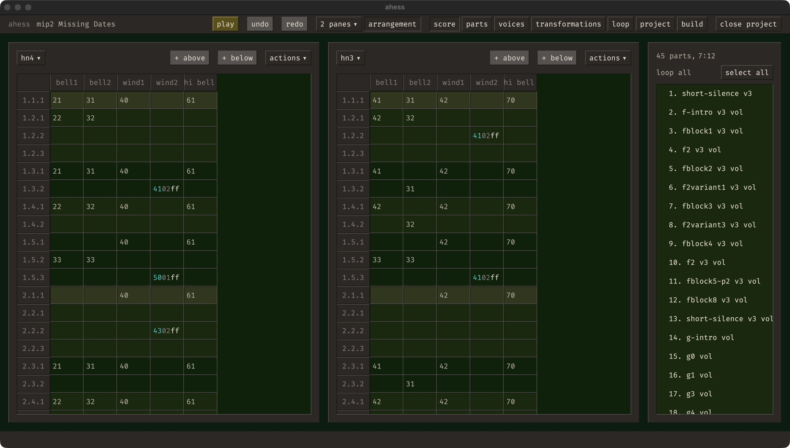

# Ahess

A native music composition app built in Rust, with a tracker-style score editor,
custom tuning systems, and its own audio rendering engine.

Ahess is a personal software and music project by Chad Stearns. It brings score
editing, instrument design, and acoustic simulation into one desktop application.
Compose in standard twelve-tone tuning or define a different musical system,
arrange reusable parts, and render the result to audio.



## Listen

Two compositions made with Ahess:

- [Music in Parts 2.1](https://www.youtube.com/watch?v=XBOYnzoK-3I)
- [Music In Parts 2.3](https://www.youtube.com/watch?v=qMAnnDsqAxI)

## What it does

- **Edit and arrange scores.** Write notes in a grid with a column for each voice.
  Work with multiple score panes, beat subdivisions, and detailed note groups;
  assemble parts into an arrangement and loop selected passages.
- **Compose with custom tunings.** Use Western twelve-tone notation, periodic
  scales defined with ratios or cents, or explicit mappings from named notes to
  frequencies. Tuning definitions are reusable across projects.
- **Explore instruments.** Combine oscillators, additive bells, a synthesized
  gamelan metallophone and clarinet, and sampled cello, flute, clarinet, harp,
  and clean guitar. Optional Surge XT voices extend the palette.
- **Shape a performance.** Control note duration, volume, and attack; transpose
  selected material, adjust or randomize volume, and add reproducible timing and
  frequency variation with a project seed.
- **Place sound in a space.** Position each voice in three dimensions. Stereo
  rendering accounts for propagation delay and distance attenuation, with six
  first-order reflections in a configurable rectangular room. Import a WAV
  impulse response for convolution processing.
- **Export a complete piece.** Render a stereo mix, individual voice stems, and
  per-voice JSON scores with frequencies and timing. Audio builds use 32-bit
  float WAV at 44.1, 48, or 96 kHz.

## Engineering

The interface uses **GPUI**, and **CPAL** handles audio output. The score model,
pitch resolution, scheduling, synthesis, spatialization, and offline rendering
are implemented in Rust.

- **Frequency-native audio:** score notation resolves to validated frequencies
  before playback. Instruments receive frequencies independently of the chosen
  tuning system. The optional macOS Surge XT host uses Audio Units and MTS-ESP
  to preserve those frequencies.
- **Shared playback and export:** live playback and offline builds use the same
  prepared score and instrument rendering path, including deterministic
  humanization and acoustic tails.
- **Typed domain boundaries:** validated types represent frequencies, note
  durations, volumes, resource identifiers, and acoustic positions. Editor text
  can remain incomplete while playback preparation validates its meaning.
- **Recoverable editing:** undo/redo, score autosave and recovery files, and
  recoverable multi-file transactions support edits spanning project metadata
  and part scores.
- **Reusable native UI:** shared components cover virtualized score grids,
  selection lists, inputs, dialogs, and workspace navigation, backed by a
  documented design system.

## Run locally

Ahess is under active development. The instructions below target macOS; other
platforms have not been verified here.

Install a current stable Rust toolchain and the Xcode command-line tools, then:

```sh
git clone https://github.com/Chadtech/ahess.git
cd ahess
cargo run --locked -- ui
```

The first build compiles GPUI and its dependencies and can take a few minutes.
Built-in instruments and prepared samples are included in the repository.
Surge XT voices additionally require the Surge XT Audio Unit and MTS-ESP
middleware; they are optional for using the app.

### Make a first score

1. Create a project with the built-in Western twelve-tone tuning.
2. In **voices**, add an instrument.
3. In **parts**, create a part and add it to the arrangement.
4. Open **score** and enter notes such as `C4`, `E4`, and `G4` in that voice's
   column. Blank cells are rests.
5. Press **play** to audition the arrangement. Use **build** to export it.

On macOS, `⌘P` toggles playback, `⌘Z` undoes an edit, and `⇧⌘Z` redoes it.

### Local data

The current app uses the source checkout as its workspace. Projects live under
`projects/`, with TOML metadata and CSV part scores; user tuning definitions live
under `tuning-systems/`. These directories are ignored by Git. Exported files
are written to each project's `build/` directory.

## Development

```sh
cargo test --locked
```

For automatic rebuilds and relaunches after code or bundled asset changes,
install `watchexec` and run:

```sh
make dev-ui
```

| Area | Source |
| --- | --- |
| Application and editing workspaces | [`src/app/`](src/app/), [`src/app.rs`](src/app.rs) |
| Shared UI and design tokens | [`src/view/`](src/view/), [`src/style.rs`](src/style.rs) |
| Project persistence and transactions | [`src/project/`](src/project/), [`src/part.rs`](src/part.rs) |
| Pitch notation and tuning library | [`src/pitch_system.rs`](src/pitch_system.rs), [`src/tuning_system.rs`](src/tuning_system.rs) |
| Playback and instrument DSP | [`src/playback.rs`](src/playback.rs), [`src/voice_rendering/`](src/voice_rendering/) |
| Spatial audio and convolution | [`src/acoustics.rs`](src/acoustics.rs), [`src/convolution.rs`](src/convolution.rs) |
| Offline audio and score export | [`src/audio_build.rs`](src/audio_build.rs) |

See the [audio architecture](docs/audio-architecture.md),
[design guide](docs/design-guide.md), and [Rust code style](docs/code-style.md)
for implementation decisions and contribution conventions. Earlier experiments
are retained in [`old/`](old/).

Sample provenance and licenses are documented with the
[VSCO 2 instruments](assets/samples/vsco2/README.md),
[clean guitar](assets/samples/clean-guitar/README.md), and
[historical impulse responses](assets/impulse-responses/recovered-noitech/README.md).
